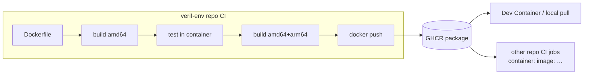

# SemiTO-V verification environment

[](LICENSE)

Open-source Docker / Dev Container environment for the **SemiTO-V** student
team: the same verification tools on every laptop and in CI.

Image (public): [`ghcr.io/semitov/semitov-verif-env:latest`](https://ghcr.io/semitov/semitov-verif-env:latest)

| Included | Role |
| --- | --- |
| Verilator, Yosys, SymbiYosys, SMT solvers | Via [OSS CAD Suite](https://github.com/YosysHQ/oss-cad-suite-build) |
| cocotb, pyuvm, cocotb-coverage | Python verification (pinned in `docker/requirements.txt`) |
| Spike (lowRISC cosim), riscv-tests, riscv-formal | ISA sim, tests, formal checkers |
| RISC-V GCC | Bare-metal RV32 programs (`gcc-riscv64-unknown-elf`) |

First-day guide: **[docs/SETUP.md](docs/SETUP.md)**.

## Quick start (normal workflow)

You do **not** need to clone this repository to do verification work. Copy
[`.devcontainer/devcontainer.json`](.devcontainer/devcontainer.json) into the
project repo you are working on, then open that project in the container.

1. Install [Git](https://git-scm.com/), [Docker](https://docs.docker.com/get-docker/), and [VS Code](https://code.visualstudio.com/) with the **Dev Containers** extension (`ms-vscode-remote.remote-containers`).
2. **Windows:** use **WSL2** before anything else. Install WSL (`wsl --install` in an admin PowerShell, then reboot), install [Docker Desktop](https://docs.docker.com/desktop/setup/install/windows-install/) with the WSL2 backend, enable your Ubuntu distro under Docker Desktop → Settings → Resources → WSL integration, and install the **WSL** extension in VS Code. Clone and open project repos **inside WSL** (for example `~/my-project`), not on `C:\`. From the WSL terminal run `code .`, then **Dev Containers: Reopen in Container**.
3. **macOS / Linux:** install Docker (Docker Desktop on macOS; Docker Engine on Linux, then `sudo usermod -aG docker $USER` and log out/in).
4. Log in to GHCR so Docker can pull the image (once per machine):
   1. On GitHub: profile picture → **Settings** → **Developer settings** → **Personal access tokens** → **Tokens (classic)** → **Generate new token (classic)**.
   2. Give it a name, set an expiry, enable the **`read:packages`** scope, and generate the token. Copy it once.
   3. In a terminal (on Windows: inside WSL), run:

   ```bash
   echo "<YOUR_PAT>" | docker login ghcr.io -u <YOUR_GITHUB_USERNAME> --password-stdin
   ```

5. Open the project folder in VS Code (`code .` from WSL on Windows) → **Dev Containers: Reopen in Container**. First open pulls `ghcr.io/semitov/semitov-verif-env:latest` (~1.3 GB; keep ~15 GB free).

Give Docker at least 4 CPUs and 8 GB of memory (Docker Desktop → Settings → Resources).
## Testing the tools (this repository)

Clone and open **this** repository only when you are developing or smoke-testing
the environment itself (not for day-to-day project work):

```bash
git clone https://github.com/semitov/semitov-verif-env.git
cd semitov-verif-env
```

On Windows, clone **inside WSL**, then `code .` from that terminal.
**Dev Containers: Reopen in Container**, wait for the image pull, then:

```bash
check-tools
make -C tests/hello
make -C tests/hello WAVES=1
make -C tests/hello formal
spike --isa=rv32i $RISCV_TESTS/isa/rv32ui-p-add && echo "Spike OK"
```

Without an IDE: `scripts/devshell.sh` or `scripts/devshell.sh make -C tests/hello`.

## Repository layout

| Path | Purpose |
| --- | --- |
| `docker/` | Dockerfile, Python pins, `check-tools`, `tap-up` |
| `.devcontainer/` | Dev Container config (pulls the GHCR image) |
| `.github/workflows/` | Image publish + CI smoke tests |
| `tests/hello/` | Hello-world sim, waves, and formal check |
| `scripts/devshell.sh` | Container shell without VS Code |
| `docs/SETUP.md` | Full onboarding and troubleshooting |

## Updating tools

Every version is pinned:

| Tool | Pin location |
| --- | --- |
| Verilator, Yosys, SymbiYosys, solvers | `OSS_CAD_SUITE_DATE` in `docker/Dockerfile` |
| Spike | `SPIKE_COMMIT` (lowRISC `ibex_cosim`) |
| riscv-formal / riscv-tests | Their `*_COMMIT` ARGs in the Dockerfile |
| Python packages | `docker/requirements.txt` |
| Base OS / RISC-V GCC | `ubuntu:24.04` + distro package |

Change pins on a branch, open a PR, merge when CI is green. The *Build verification image* workflow publishes a new multi-arch image. Teammates refresh with **Dev Containers: Rebuild Container**.

## Publishing the image



Pushes that touch `docker/` (or a manual workflow run) rebuild via
[`.github/workflows/image.yml`](.github/workflows/image.yml) and push
`ghcr.io/semitov/semitov-verif-env:latest` (amd64 + arm64).

If the package is **Public**, pulls work without a token. If it is private (or
pulls return `denied` / `unauthorized`), use the classic PAT login steps in
**Quick start** above.

## License

This project is licensed under the [Apache License 2.0](LICENSE).

Third-party tools inside the image (OSS CAD Suite, Spike, etc.) keep their own licenses; this repository’s license covers the Dockerfiles, scripts, tests, and docs authored here.

## Contributing

See [CONTRIBUTING.md](CONTRIBUTING.md). Issues and pull requests from the team (and the wider community) are welcome.
